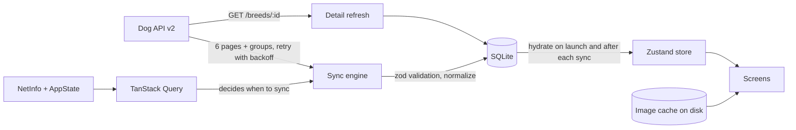
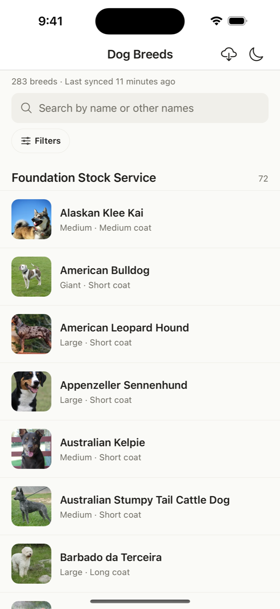
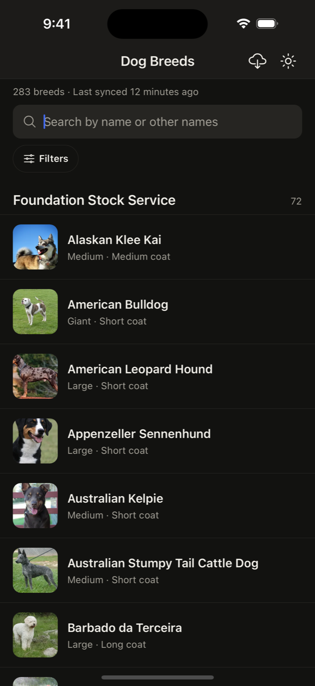
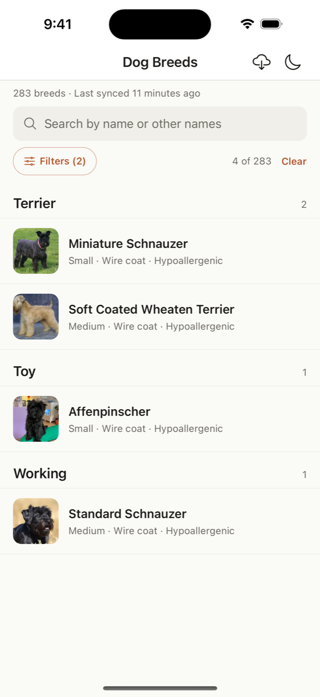
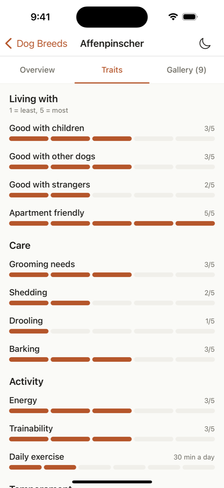
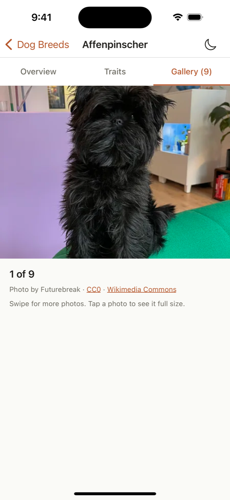
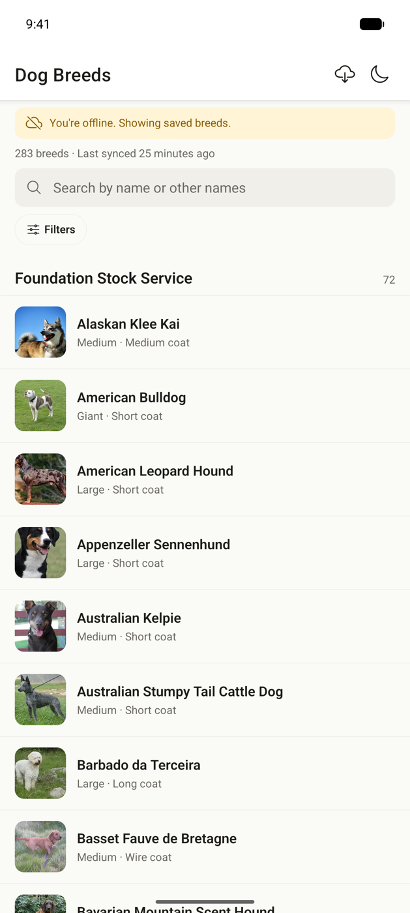

# Dog Breeds

An offline-first React Native app for browsing all 283 breeds from the [Dog API](https://dogapi.dog/docs/api-v2). It syncs once, keeps everything on the device, and works fully offline after that, including the list thumbnails. Search and filter by group, size, coat, hypoallergenic and how good a breed is with children, other dogs and strangers, then open any breed for its facts, trait scores and a credited photo gallery.

Built with Expo (SDK 58), TypeScript in strict mode, SQLite, Zustand, TanStack Query and FlashList.

## Quick start

You need Node 20 or newer (developed on Node 22), plus either the iOS Simulator (Xcode) or an Android emulator (Android Studio). Expo Go is installed on the simulator or emulator automatically.

```bash
npm install
cp .env.example .env
npm run ios        # or: npm run android
```

There's no native build step: the app runs in Expo Go, so the first launch takes about a minute. On first launch it downloads the 283 breeds (about 4 seconds) and then the thumbnails in the background. From then on it opens from the local database, online or not.

| Command                           | What it does                                                                    |
| --------------------------------- | ------------------------------------------------------------------------------- |
| `npm run ios` / `npm run android` | Start Metro and open the app in Expo Go                                         |
| `npm test`                        | Jest unit and component tests (37 suites, 204 tests)                            |
| `npm run typecheck`               | `tsc --noEmit` in strict mode                                                   |
| `npm run lint`                    | ESLint (no `any`) and Prettier                                                  |
| `npm run build:ios`               | Release build, installed on the booted iOS simulator                            |
| `npm run build:android`           | Release APK at `android/app/build/outputs/apk/release/app-release.apk`          |
| `npm run e2e`                     | Maestro end-to-end flow (needs [Maestro](https://maestro.mobile.dev) installed) |

Environment variables are all optional and documented in [`.env.example`](.env.example): API base URL, page size (48), when data counts as stale (6 hours), the photo cache budget (100 MB), and a switch for the list benchmark.

## Builds

Release builds are attached to the repository's [GitHub Releases](https://github.com/kunaltyagi760/Dog_Breed_Assessment/releases) rather than committed:

| Build                               | File                                  | Install                                                 |
| ----------------------------------- | ------------------------------------- | ------------------------------------------------------- |
| iOS simulator (arm64)               | `DogBreeds-ios-simulator.zip` (15 MB) | Unzip, then `xcrun simctl install booted DogBreeds.app` |
| Android APK (all CPU types, 106 MB) | `app-release.apk`                     | `adb install app-release.apk`, or open it on a device   |

To produce them yourself, run `npm run build:ios` or `npm run build:android`. Both run `expo prebuild` first. The generated `ios/` and `android/` folders are git-ignored, because Expo recreates them from `app.json`.

## Architecture overview

The app treats the device as the source of truth. A sync engine fetches the breed list from the API as 6 pages of 48, three pages at a time. Each page retries on its own with exponential backoff, is validated with zod, and is written to SQLite in its own transaction as soon as it arrives. If a page fails, the pages that succeeded are kept, nothing cached is deleted, and the list shows the saved data with a banner saying what couldn't be refreshed. Only a sync that got every page moves "Last synced", and only that kind of sync removes breeds the API no longer returns.

The UI never reads from the network. At launch, SQLite is loaded into a normalized Zustand store (`byId` / `allIds`), and screens read from that store. Each breed has a slim list row (name, group, thumbnail, size band, coat category and the scores the filters use), so the list, search and filters never touch the full nested record. The detail screen reads the full record from SQLite, so it opens instantly, then refreshes that one breed with `GET /breeds/:id` in the background.

TanStack Query decides _when_ to sync: on launch and when the app returns to the foreground if the data is more than 6 hours old or the last sync failed, every time the network comes back, and on pull-to-refresh. Images go through a disk cache of their own. All 283 thumbnails are pinned (about 6 MB) and download in the background on unmetered connections. Gallery and full-screen photos share a 100 MB budget, and the least recently viewed are removed first.



The full design, including the SQLite schema, the sync rules for every failure case, and the image cache, is in [docs/ARCHITECTURE.md](docs/ARCHITECTURE.md).

## Key technical decisions

**State management: Zustand + TanStack Query.** TanStack Query handles network concerns: retry with backoff, deduplicated requests, and refetching on reconnect and foreground, wired to NetInfo and AppState. Zustand holds the normalized breed data and the filters. Components subscribe to a slice, so a list row re-renders only when its own breed changes. I picked it over Redux Toolkit because, for one entity type and a filter object, RTK's ceremony isn't worth it. RTK Query would also duplicate what TanStack Query already does.

**Database: expo-sqlite.** It runs in Expo Go, so the quick start needs no native build. It writes each page atomically in a transaction, and its real schema lets the list's columns stay separate from the full JSON record used by the detail screen. AsyncStorage would mean rewriting one 1.8 MB blob on every save. WatermelonDB and MMKV need a native build.

**Offline sync: device first, network second.** Launch reads SQLite and never waits for the network. Syncs happen on reconnect, on foreground and on launch when data is stale, and on pull-to-refresh. Partial failures keep everything that worked. When the app is offline it checks connectivity every few seconds, so the offline banner clears and a sync starts as soon as the connection is back.

Everything else, from coat categories and size bands to the image variant strategy, is explained with its alternatives in [docs/DECISIONS.md](docs/DECISIONS.md).

## Performance report

Measured on a release build on the iPhone 15 Pro simulator. The method and raw numbers are in [docs/PERFORMANCE.md](docs/PERFORMANCE.md).

| Target                                | Result                                                                               |
| ------------------------------------- | ------------------------------------------------------------------------------------ |
| < 3 s to interactive with cached data | **0.63 s** to a usable list, **1.06 s** fully drawn (median of 5 cold starts)        |
| 60 fps list scroll                    | **60.1 fps average, 60.0 minimum** across the full list (FlashList benchmark)        |
| < 150 MB memory                       | **123 MB peak** over a session of scrolling the full list and browsing two galleries |
| Bundle size                           | **3.9 MB** Hermes bytecode; 2.5 MB of JS, of which the app's own code is 71 KB       |

Bundle breakdown (2,477 KB of JS before bytecode compilation):

| Package                              | Size   |
| ------------------------------------ | ------ |
| react-native                         | 594 KB |
| zod                                  | 494 KB |
| expo-router (incl. React Navigation) | 466 KB |
| expo                                 | 111 KB |
| app code (`src/`)                    | 71 KB  |
| @shopify/flash-list                  | 71 KB  |
| react-native-screens                 | 67 KB  |
| @tanstack/query                      | 65 KB  |
| everything else                      | 538 KB |

<p>
  
  
</p>

Left: FlashList's benchmark result after scrolling all 283 rows twice. Right: memory over the session, plotted from `phys_footprint` sampled every second.

## Screenshots

| Breed list (light)                                                                     | Breed list (dark)                                                                    | Filters applied                                                                                                          |
| -------------------------------------------------------------------------------------- | ------------------------------------------------------------------------------------ | ------------------------------------------------------------------------------------------------------------------------ |
|  |  |  |

| Detail: traits                                                                                | Detail: gallery                                                                               | Offline (Android)                                                                                                |
| --------------------------------------------------------------------------------------------- | --------------------------------------------------------------------------------------------- | ---------------------------------------------------------------------------------------------------------------- |
|  |  |  |

## Features

- All 283 breeds, grouped by breed group with sticky headers, a thumbnail and a one-line summary (size, coat, hypoallergenic).
- Debounced search by name or other names. Accents and case are ignored, and every word has to match.
- Filters for breed group, size band and coat (short, medium, long, wire, hairless), hypoallergenic (any, yes, no), and a minimum score for good with children, other dogs and strangers. The sheet shows a live result count.
- A detail screen with three tabs. Overview has the description, life span, male and female weight and height, origin, coat, other names, kennel clubs and sources. Traits shows all 11 numeric traits as scales plus temperament tags. Gallery is swipeable, credits the author, licence and source of every photo, and opens a full-screen viewer.
- Everything works offline, thumbnails included, with a "Last synced" label, offline and partial-failure banners, and an automatic sync when the connection returns.
- Light and dark themes that follow the system, with a toggle in the header that's remembered.
- Screen reader labels and roles throughout. Rows grow with large text, trait bars announce their values, and sheets are modal.

## Testing

```bash
npm test
```

37 suites and 204 tests cover:

- the sync engine against a fake API (complete, partial, failed, malformed records, shifted pages);
- the image cache's eviction rules;
- filters and sections;
- the detail data hook;
- the main components.

The sync engine and the image cache take their dependencies (API, database, file system) as parameters, so they're tested without a device. CI runs typecheck, lint and tests on every push to `main` and on pull requests ([`.github/workflows/ci.yml`](.github/workflows/ci.yml)).

`.maestro/browse-filter-detail.yaml` is an end-to-end flow for the critical path: list loads, a filter narrows it, search finds a breed, and its tabs open. Run it with `npm run e2e` while the app is open in the simulator. On Android, change `appId` to `host.exp.exponent` and run `adb reverse tcp:8081 tcp:8081` first.

## Project structure

```
src/
  app/          screens (Expo Router): list, breeds/[id], storage
  api/          HTTP client, zod schemas, React Query wiring
  db/           SQLite connection, migrations, repository, write queue
  domain/       breed types, derived fields (size band, coat category), filters, sections
  sync/         sync engine, single-breed refresh, sync policy and hooks
  images/       disk image cache, CachedImage, thumbnail prefetch
  store/        Zustand stores (breeds, filters, theme)
  features/     list, filter sheet, detail tabs, gallery
  components/   shared UI (text, buttons, chips, banners, sections, tags)
  hooks/        online status, hydration, debounce, clock
  lib/          retry, backoff, concurrency, formatting
  theme/        light and dark tokens
  __tests__/
docs/
  ARCHITECTURE.md   system design, data flow, schema
  DECISIONS.md      technical choices and their alternatives
  PERFORMANCE.md    startup, FPS, memory and bundle measurements
  screenshots/
```

## A note on the data

The brief and the API docs disagree with the live API in a few places. For example, the live default page size is 30, not 48; some breeds have 10 photos; and "wire" is a coat type rather than a coat length. The app follows what the live API actually returns. The specifics, and how each one is handled, are at the top of [docs/DECISIONS.md](docs/DECISIONS.md).
