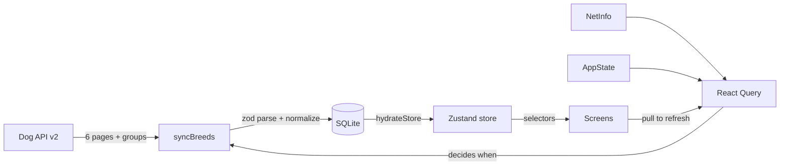

# Architecture

The app is offline-first: SQLite on the device is the source of truth, and the network only ever refreshes it. Screens read from an in-memory Zustand store that is loaded from SQLite at launch and reloaded after every sync. Nothing on screen waits for the network unless there's no saved data at all.

## Data flow



1. Launch. `useHydration` opens the database, runs migrations, and loads the slim list rows, the groups and the sync metadata into the store. The root layout shows a spinner until that finishes, which takes a few milliseconds once data is cached.
2. Deciding to sync. `useBreedSync` registers one React Query query whose `queryFn` is the sync. React Query is seeded with the persisted `lastSyncedAt`, so it knows how old the data is, and it refetches on mount, on reconnect (NetInfo) and on foreground (AppState) only when the data is stale. Stale means older than `EXPO_PUBLIC_STALE_AFTER_HOURS`, or the last attempt failed.
3. Syncing. `syncBreeds` fetches groups and page 1 together. Page 1's `meta.pagination.last` says how many pages exist; pages 2 to N are fetched three at a time. Each request retries on its own with exponential backoff and jitter. Each page is normalized and written in its own transaction as soon as it arrives.
4. Showing the result. After the sync, whether it succeeded or not, the store is reloaded from SQLite so the UI shows exactly what's saved.

## Folder layout

```
src/
  app/          Expo Router screens (_layout, index, breeds/[id])
  api/          HTTP client, zod schemas for API responses, React Query setup
  db/           SQLite connection, migrations, repository
  domain/       Breed types and the rules that derive size band, coat category, etc.
  sync/         The sync engine and the hooks that run it
  store/        Zustand stores (breed data, theme preference)
  features/     Screen-specific components (breeds list, sync status)
  components/   Shared UI used across screens
  hooks/        Generic hooks (online status, ticking clock, hydration)
  lib/          Small pure helpers (retry, backoff, concurrency, text)
  theme/        Colour tokens for light and dark, spacing, type sizes
```

The dependency direction is `app → features → store / sync → db / api → domain / lib`. `domain` and `lib` import nothing from the rest of the app, which is why most of the tests can run without React or a database.

## Sync engine

`syncBreeds` takes its dependencies as arguments (`api`, `repo`, `pageSize`, a clock and retry settings). The tests run it against a fake server and an in-memory repository, and the app runs it against the real API and SQLite.

| Situation                                           | What happens                                                                                                                                                 |
| --------------------------------------------------- | ------------------------------------------------------------------------------------------------------------------------------------------------------------ |
| Every page and the groups load                      | Status `complete`. Breeds that weren't in this sync are deleted, and `lastSyncedAt` is updated.                                                              |
| Some pages fail after retries                       | Status `partial`. The pages that worked are saved, nothing is deleted, and `failedPages` plus `lastError` are stored. The banner says how many pages failed. |
| Groups fail                                         | Status `partial`. Breeds are still saved, and the old group labels stay.                                                                                     |
| Total in `meta.records` is higher than what arrived | Status `partial`, nothing is deleted. Usually means records shifted between pages mid-sync.                                                                  |
| Page 1 fails                                        | Throws `SyncFailedError`, records the error, and leaves the cache untouched.                                                                                 |
| A single record fails validation                    | Skipped and counted. The rest of its page is kept.                                                                                                           |

Deletion uses the sync start time: every breed written in this pass gets `synced_at = startedAt`, so after a full pass, `DELETE ... WHERE synced_at < startedAt` removes exactly the breeds the API no longer returns. Nothing gets deleted after a partial pass, because a missing breed might be on a page that failed.

Writes go through a small queue in the repository. Pages download in parallel, but SQLite transactions on one connection can't overlap.

## SQLite schema

Migrations live in `src/db/migrations.ts` and are tracked with `PRAGMA user_version`. Each migration and its version bump run in the same transaction.

```sql
groups (
  id TEXT PRIMARY KEY,
  name TEXT NOT NULL,              -- "Herding Group"
  label TEXT NOT NULL              -- "Herding"
)

breeds (
  id TEXT PRIMARY KEY,
  name TEXT NOT NULL,
  group_id TEXT,
  thumb_url TEXT,                  -- first image's 200x200 thumb
  size_band TEXT,                  -- small | medium | large | giant
  coat_category TEXT NOT NULL,     -- short | medium | long | wire | hairless | unknown
  hypoallergenic INTEGER NOT NULL,
  good_with_children INTEGER,
  good_with_dogs INTEGER,
  good_with_strangers INTEGER,
  search_text TEXT NOT NULL,       -- name + other names, lowercased, accents removed
  payload TEXT NOT NULL,           -- validated API record (JSON) for the detail screen
  synced_at INTEGER NOT NULL       -- start time of the sync that wrote this row
)

sync_meta (
  key TEXT PRIMARY KEY,
  value TEXT NOT NULL              -- JSON: lastSyncedAt, lastAttemptAt, failedPages, lastError
)
```

The typed columns are the list projection, so the list, search and filters never parse `payload`. `payload` holds the API record rather than the normalized `Breed`, so normalization rules can change without a data migration: the detail screen re-runs the same schema and `toBreed` on read. There are no secondary indexes, because the list always reads all ~283 rows.

Rows coming back from SQLite go through a zod schema too. `getAllAsync<T>()` only casts, and I didn't want unchecked data entering the store.

## State

`useBreedStore` holds normalized data:

```ts
breeds: { byId: Record<string, BreedListItem>, allIds: string[] }   // allIds sorted by name
groups: { byId: Record<string, Group>, allIds: string[] }
syncMeta: SyncMeta
hydrated: boolean
```

The list passes only ids to FlashList. Each row selects its own breed from `byId`, so when one breed changes, only that row re-renders.

`useThemeStore` holds the theme preference (`system`, `light` or `dark`), saved with `expo-sqlite/kv-store`. Choosing a theme calls `Appearance.setColorScheme`, so `useColorScheme()`, native dialogs and the keyboard all follow the toggle in the header. The preference is applied before the first render, so a saved dark theme doesn't flash light on launch.

## Errors

- The root layout exports Expo Router's `ErrorBoundary`, which catches render errors that escape the screens.
- The list body is wrapped in `react-error-boundary`.
- If the database can't be opened, the root layout shows an error screen with a retry button.
- API errors are typed: `NetworkError` and `HttpError` 5xx/429 are retried, while other 4xx errors and `InvalidResponseError` fail immediately.
