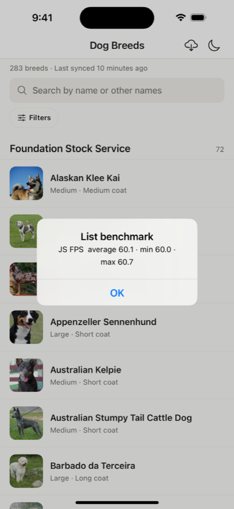
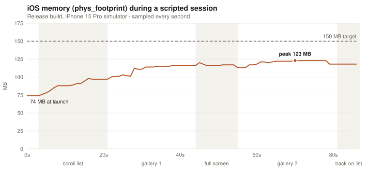

# Performance

Measured on 22 Oct 2026 against the brief's targets. Everything here can be reproduced with the commands in each section.

## Summary

| Target (from the brief)                             | Result                                                                                        | How it was measured                                                |
| --------------------------------------------------- | --------------------------------------------------------------------------------------------- | ------------------------------------------------------------------ |
| Initial load < 3 s to interactive, with cached data | **0.63 s** to a usable list, **1.06 s** fully drawn with thumbnails (median of 5 cold starts) | Release build, data already in SQLite                              |
| 60 fps sustained list scroll                        | **60.1 fps average, 60.0 minimum** on the JS thread                                           | FlashList's `useBenchmark`, two automated passes over all 283 rows |
| Memory < 150 MB under normal use                    | **123 MB peak**, 74 MB at launch                                                              | `phys_footprint` sampled every second through a scripted session   |
| Bundle size documented                              | 3.9 MB Hermes bytecode (2.5 MB JS before compilation)                                         | `expo export`, source-map breakdown below                          |

## Test setup

- iOS: release build (`-configuration Release`, Hermes bytecode, no dev tools) on the iPhone 15 Pro simulator (iOS 17.2) on an Apple M2 Pro Mac.
- Android: Android 17 emulator (arm64, 1344×2992 display), used for functional screenshots. No Android performance numbers are reported; the commands to collect them from a release APK are in [Android](#android).
- Data: all 283 breeds already synced, all thumbnails in the image cache, so the runs measure the app rather than the network.

Simulator and emulator numbers aren't phone numbers. A simulator uses the Mac's CPU and memory allocator, so absolute values differ from a real device, but they're consistent from run to run, which is what matters for comparing changes.

## Bundle

```bash
npx expo export --platform ios --platform android      # Hermes bytecode, what ships
npx expo export --platform ios --no-bytecode --source-maps --output-dir dist-js
npx source-map-explorer dist-js/_expo/static/js/ios/*.js dist-js/_expo/static/js/ios/*.js.map --no-border-checks
```

| Output                               | Size              |
| ------------------------------------ | ----------------- |
| iOS bundle (Hermes bytecode)         | 3.9 MB            |
| Android bundle (Hermes bytecode)     | 3.9 MB            |
| Plain JS before bytecode compilation | 2.5 MB (2,477 KB) |
| App code (`src/`)                    | 71 KB (2.9%)      |

Where the 2,477 KB of JavaScript comes from:

| Package                                 | Size   | Share |
| --------------------------------------- | ------ | ----- |
| react-native                            | 594 KB | 24.0% |
| zod                                     | 494 KB | 19.9% |
| expo-router (includes React Navigation) | 466 KB | 18.8% |
| expo                                    | 111 KB | 4.5%  |
| app code (`src/`)                       | 71 KB  | 2.9%  |
| @shopify/flash-list                     | 71 KB  | 2.9%  |
| react-native-screens                    | 67 KB  | 2.7%  |
| @tanstack/query-core + react-query      | 65 KB  | 2.6%  |
| @react-native/virtualized-lists         | 49 KB  | 2.0%  |
| expo-sqlite                             | 27 KB  | 1.1%  |
| expo-file-system                        | 22 KB  | 0.9%  |
| react-native-tab-view                   | 20 KB  | 0.8%  |
| expo-image                              | 11 KB  | 0.5%  |
| unmapped / runtime glue                 | 215 KB | 8.6%  |
| everything else                         | 194 KB | 7.8%  |

zod is the second-largest package. Of its 494 KB, 269 KB is error-message translations for about 40 languages, which the app never shows. Validation itself is about 225 KB. Two ways to win most of that back, if bundle size became a priority:

- switch the files that use zod to `zod/mini`, which tree-shakes per function and doesn't pull the locales in;
- or move to Valibot, which is built for that from the start.

Both are mechanical changes confined to the five files that build schemas (`src/api/schemas.ts`, `src/db/rows.ts`, `src/db/sqliteRepository.ts`, `src/config/env.ts`, `src/images/sqliteCacheIndex.ts`) plus a type import in `src/api/dogApi.ts`. I left zod in place because its schemas read clearly and the bundle is already Hermes bytecode, which is memory-mapped and doesn't need to be parsed at startup.

## Startup

```bash
xcrun simctl terminate booted com.tripare.dogbreeds
xcrun simctl launch booted com.tripare.dogbreeds   # then screenshot back to back until the list settles
```

Five cold starts of the release build, with the 283 breeds and all thumbnails already on disk. Each run was timed from the launch command, with screenshots taken back to back (about every 0.2 s).

| Run        | List rendered (names, groups, search) | Fully drawn with thumbnails |
| ---------- | ------------------------------------- | --------------------------- |
| 1          | 0.65 s                                | 1.08 s                      |
| 2          | 0.62 s                                | 1.04 s                      |
| 3          | 0.63 s                                | 1.07 s                      |
| 4          | 0.62 s                                | 1.06 s                      |
| 5          | 0.63 s                                | 1.06 s                      |
| **Median** | **0.63 s**                            | **1.06 s**                  |

The first frame after the launch animation already contains the full list. The app never waits for the network on launch: it reads the slim list rows from SQLite (a single `SELECT` of 283 rows) and the image-cache index, and a background sync only starts if the data is older than six hours or the last sync failed. The 0.4 s between "list" and "fully drawn" is the thumbnails being decoded from local files during iOS's launch zoom.

## Scrolling: 60 fps



The list was measured with FlashList's own benchmark (`useBenchmark`). It drives the real list programmatically, scrolling from the first row to the last and back, and samples the JS thread's frame rate the whole way. It's built into the app behind a switch that's off by default:

```bash
EXPO_PUBLIC_LIST_BENCHMARK=1 npm run build:ios    # or set it in .env before a release build
```

Two passes over all 283 rows and 9 group headers, release build:

|         | JS-thread FPS |
| ------- | ------------- |
| Average | 60.1          |
| Minimum | 60.0          |
| Maximum | 60.7          |

The JS frame rate never dropped below 60 in any sampling interval of the run. The UI thread isn't the risk here. With the New Architecture, scrolling itself is native, and what can drop frames is JS work during scroll (FlashList recycling cells and rendering rows), which is what this benchmark measures. Three things keep that work small:

- rows receive only an id and read a slim, pre-computed row from the store, never the full breed (see "Performance: how heavy each row is" in DECISIONS.md);
- headers and rows are separate item types, so FlashList never turns a header cell into a breed row;
- images come from local files, so a recycled row never waits on the network.

Instruments' Animation Hitches instrument needs a physical iPhone; on a device it's the next measurement to add.

<br clear="right" />

## Memory

```bash
footprint $(pgrep -f DogBreeds.app/DogBreeds) | grep phys_footprint    # every second, during the session
```

`phys_footprint` is the number iOS uses to decide when to terminate an app, and the one Xcode's memory gauge shows. Resident size (`ps -o rss`) reads about 130 MB higher on a simulator because it counts system frameworks shared with every other app.

The session: launch, scroll to the end of the list and back, open a breed and swipe through all 10 gallery photos, open the full-screen viewer (the 1200px variant) and swipe through three more, go back, open a second breed and swipe through its 8 photos, return to the list.



| Point in the session                               | Memory     |
| -------------------------------------------------- | ---------- |
| Launch, list on screen                             | 74 MB      |
| After scrolling all 283 rows and back              | 98 MB      |
| After the first gallery and the full-screen viewer | 120 MB     |
| Peak, during the second gallery                    | **123 MB** |
| Back on the list                                   | 118 MB     |

### What keeps it flat: decoding images on demand

Image memory is the biggest variable in this app. A 200×200 thumbnail is 160 KB once decoded, a 600px gallery photo up to 1.4 MB, and a 1200px full-screen photo up to 5.8 MB. Every file is already on disk in the app's image cache, so expo-image is configured not to keep its own decoded copies (`cachePolicy="none"`). An image is decoded from its local file when its view appears and released when the view goes away. Decoding a 9 to 27 KB WebP thumbnail from local storage takes a few milliseconds, so scrolling stays smooth while memory stays bounded by what's on screen.

The same session with expo-image's memory cache enabled, for comparison:

| Decoded images kept in memory                  | Peak       |
| ---------------------------------------------- | ---------- |
| All images                                     | 177 MB     |
| Thumbnails only                                | 162 MB     |
| **None: decode from disk on demand (shipped)** | **123 MB** |

## Android

Android was used for the functional screenshots. Measuring a release APK uses the platform's standard tools:

```bash
npm run build:android                                      # android/app/build/outputs/apk/release/app-release.apk
adb install -r android/app/build/outputs/apk/release/app-release.apk

adb shell am start -W -n com.tripare.dogbreeds/.MainActivity    # cold start: TotalTime
adb shell dumpsys gfxinfo com.tripare.dogbreeds reset
adb shell input swipe 670 2400 670 900 120                     # repeat to fling through the list
adb shell dumpsys gfxinfo com.tripare.dogbreeds                # frame percentiles and janky frames
adb shell dumpsys meminfo com.tripare.dogbreeds | grep "TOTAL PSS"
```

Expo Go isn't a fair stand-in for these. Its process carries Expo Go's own native modules, the developer tools and an unminified development bundle, so it reports several hundred MB regardless of the app.

## App size

| Build                                           | Size                        |
| ----------------------------------------------- | --------------------------- |
| iOS release, simulator (arm64), `DogBreeds.app` | 57 MB on disk, 18 MB zipped |
| JS bundle inside it (Hermes bytecode)           | 3.9 MB                      |

An App Store build would be smaller: App Store builds are thinned per device and compressed, and the simulator build is uncompressed.

## Reproducing everything

1. `npm run build:ios` (or `npm run build:android`) to get a release build.
2. Launch it once online and let it sync and download thumbnails (check the Offline storage screen: 283 of 283).
3. Run the startup, benchmark and memory steps above.
